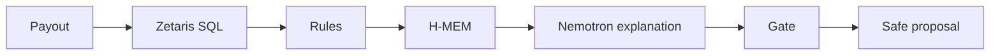

# Spendwarden

Spendwarden reviews a proposed treasury payout and decides APPROVE, ESCALATE, or BLOCK. Hard rules own the decision. Zetaris supplies the evidence, Meterless H-MEM holds a signer exception, and Nemotron only explains the choice the rules already made. An approval proposes a Sepolia Safe transaction. It does not execute one.



## Setup

You need Node, a local Zetaris gateway, and a Sepolia Safe whose threshold is greater than 1. Zetaris uses port 3000, so this app uses port 3001.

```bash
npm install
copy .env.example .env.local
npm run build:sample
```

Fill `.env.local` with the Zetaris REST URL, org id, API key, Lightning database, and data-path prefix. Register the sample views once:

```bash
npm run zetaris:check -- --register
```

Optional: run Meterless Nightshift at `http://127.0.0.1:8088/v1` and set `METERLESS_API_TOKEN`. If it is down, the rule decision is still returned and the model step says `explanation skipped`.

For the Safe, set `SAFE_ADDRESS`, `SAFE_THRESHOLD` above 1, and `SAFE_PROPOSER_PRIVATE_KEY` in `.env.local` only. `npm run safe:setup` can deploy a threshold-2 Safe. Keep private keys out of git.

```bash
npm run dev
```

Open [http://localhost:3001](http://localhost:3001).

## Checks

```bash
npm test
npm run demo
```

`npm run demo` rebuilds the local payment parquet and runs scenarios A–D against Zetaris. It uses a fresh memory store for that run.

- A Helios Cloud approves within policy and reuses an open Safe proposal when one already matches.
- B Northline Audit blocks the duplicate invoice and writes an incident note.
- C Kite Supplies escalates the new wallet and asks one question.
- D1 Orbit Legal escalates the per-transaction cap, then approves at 0.8 after the Orbit exception and cites that memory.
- D2 Pylon Design stays an escalation. The Orbit exception does not apply to it.

## Sample data

Everything under `data/sample/` is fictional. It is not a real treasury, vendor list, or payment history. Circle Sepolia USDC (`0x1c7D4B196Cb0C7B01d743Fbc6116a902379C7238`) is a testnet token with no financial value.

## Safe

The proposer signs the SafeTx hash so the Safe Transaction Service accepts the proposal. Spendwarden never executes the transaction, never adds a second signature, and refuses a threshold that is not above 1.

## Sponsor tech

- Zetaris federated SQL reads policy, payments, vendor, budget, and Safe history. One statement per lookup.
- Meterless H-MEM stores a signer exception. Only an over-cap escalation can become an approval, and the original reason stays.
- NVIDIA Nemotron, through Meterless Nightshift, explains at temperature 0. The gate keeps the rule decision if the model disagrees or is unavailable.
- Cursor is the workspace this agent was built in.
